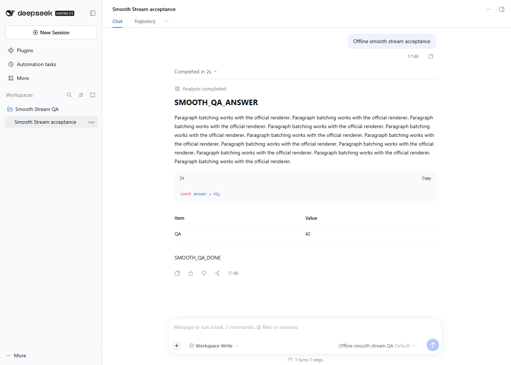
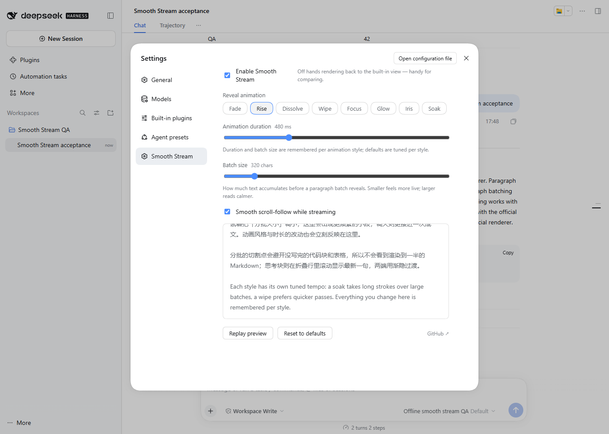
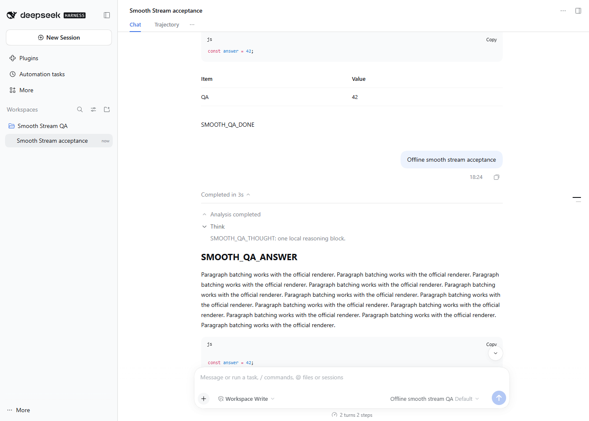

# Official DSH 0.2.1-rc.5 implementation review

Event: `compatibility:smooth-stream:dsh-0.2.1-rc.5`, 2026-10-30.
Source base: `cd0b8893a27d2d65545fed7cc044164517625dd3`.
Official tag `dsh-v0.2.1-rc.5` resolves to
`b830ec950faba0a46dda564be3e2d854afed94f1` (`git ls-remote` checked).
`npm view @deepseek-ai/dsh dist-tags --json` returned latest/next
`0.2.1-rc.5`, alpha `0.2.2-alpha.2`.

## Findings and changes

The original package could load in rc.5, but npm could not resolve it beside
the official rc.5 host. Packing the original 1.4.0 source and running
`npm install --package-lock-only --ignore-scripts --strict-peer-deps
@deepseek-ai/dsh@0.2.1-rc.5 <original-tarball>` in an empty owned prefix
reproduced `ERESOLVE`. The new semver regression also failed specifically at
`npm must accept 0.2.1-rc.5` before the manifest change.

Both manifest declarations now append the exact `|| 0.2.1-rc.5` arm, retaining
the previous range and rc.2 support. npm's default semver excludes a prerelease
unless the matching comparator set admits that prerelease's version tuple.
The old exact rc.2 arm therefore did not admit rc.5. DSH's published
`dsh-app-boot/lib/index.js` uses `semver.satisfies(..., { includePrerelease:
true })` and gives `engines.dsh` precedence over peers: it already accepted
the old declaration. This change fixes npm resolution, not a host rejection.
The regression checks npm and host semantics, retained targets, exclusion of
future prerelease lines, and lockfile root metadata consistency. `semver` is
an explicit development dependency; its already-locked version is unchanged.

Real Edge settings acceptance additionally reproduced a pre-existing CSS
precedence defect: under `prefers-reduced-motion: reduce`, selecting Rise
computed `animation-name: dss-rise` instead of `none`. Style-specific selectors
outweighed the accessibility rule. The same precedence problem affected the
wipe overlay and conversation scroll-follow rule. Match their specificity in
the final media query, preserving ordinary animations. Build the shipped
`lib/client.js` from `plugin.client.js`.

## Published API inspection

Compared independently installed official `0.2.1-rc.2` and `0.2.1-rc.5` packages:

- Chat's assistant-content, turn-process, and AssistantNodeView declarations
  are byte-identical. The `conversation.chat.node` owner still supplies
  `groupPart`, `node`, `turnProcess`, `useTurnData`, `fileMentions`, `openFile`,
  and `loadImage`. However, byte-identical node declarations do not imply
  identical display behavior: rc.5's `reasoningText()` prepares the raw model
  text in ReasoningRow and live process detail. It strips a leading signature
  envelope plus following LF/CRLF, suppresses incomplete prefixes/envelopes,
  and hides rows with no displayable text. The reasoning-body/content factory
  also exposes `rawText` separately from display text.
- Settings slot, renderer, locale, and module client entry declarations are
  byte-identical. Existing `slots.inject/register`, locale registration/binding,
  and client service injection remain usable.
- The official chat client still uses `MarkdownText` from
  `@deepseek-ai/dsh-client-ui-primitives` and `[data-conversation-scroll]`.
  Primitives are embedded in the official web frontend, not a separately
  installed package. Browser screenshots show native highlighted code, Copy,
  and table rendering through Smooth Stream.
- `renderMessageImages` remains absent from the current chat owner contract;
  the existing `loadImage` fallback is retained. No new gallery claim is made.

Because Smooth Stream replaces the entire assistant node, it must perform
the host's reasoning display preparation itself. It now does so before
history/live reveal measurements, summaries, expanded bodies and fallback;
original host block data is left intact. This preparation also works on the
retained older hosts. No README, changelog, or package version edits belong
to this implementation.

## Reproduction commands and scope

All paths below are relative to the owned worktree unless otherwise stated.
Scratch root is `..`; the owned worktree is its `repo` child.
No repository AGENTS.md or additional acceptance
script was present. Existing package checks and publication test fixtures were
inspected before use.

```powershell
npm ci --cache ../npm-cache --no-audit --no-fund
npm install --prefix ../runtime-rc5 @deepseek-ai/dsh@0.2.1-rc.5 --cache ../npm-cache --no-audit --no-fund
npm install --prefix ../runtime-021rc2 @deepseek-ai/dsh@0.2.1-rc.2 --cache ../npm-cache --no-audit --no-fund
npm install --prefix ../runtime-020rc2 @deepseek-ai/dsh@0.2.0-rc.2 --cache ../npm-cache --no-audit --no-fund
npm install --package-lock-only --ignore-scripts --no-audit --no-fund --cache ../npm-cache
npm test
node --test scripts/npm-publish.test.mjs
npm run check:package
git diff --check
```

For acceptance, set `DSH_QA_MODULES` to each runtime's absolute `node_modules`,
`DSH_QA_TMP` to the scratch root, and `DSH_QA_ARTIFACTS` to its `artifacts`
directory, then run `node scripts/run-dsh-acceptance.mjs`. Set `TEMP` and `TMP`
to the scratch root for temporary package/browser output. The runner now logs
runtime/browser versions, home, loopback origin, and host PIDs and stops each
host before removing its unique profile. `DSH_QA_SETTINGS=1` additionally checks
the actual settings UI, all eight normal/reduced animation styles, wipe overlay,
scroll-follow reduced motion, disabled renderer persistence after browser reload,
and re-enabling the renderer.

Strict npm resolution of the changed packed package succeeded in `../peer-after`:

```powershell
npm pack --pack-destination ../peer-after --json --silent
npm install --prefix ../peer-after --package-lock-only --ignore-scripts --strict-peer-deps --no-audit --no-fund --cache ../npm-cache @deepseek-ai/dsh@0.2.1-rc.5 ./../peer-after/dsh-plugin-smooth-stream-1.4.0.tgz
```

The resulting peer lock selects DSH `0.2.1-rc.5` and Smooth Stream `1.4.0`
with the new range. An initial 60-second timeout was retried with sufficient
time and succeeded. Installation uses neither force nor legacy peer resolution.

## Validation record

Environment: Windows, Node `22.19.0`, npm `10.9.3`, isolated headless Microsoft
Edge `156.0.4314.50`, viewport 1400×1000. Official CLI/Web runtimes use the
existing deterministic `qa-local` / `qa-model` LlmAdapter fixture. The fixture
creates and flushes real official sessions and streams reasoning and Markdown
through the actual web host. No remote provider or model credentials are used.

Initial acceptance matrix passed on all three official versions, fresh and
after host restart: saved history, live followup, exactly one reasoning/answer
per turn, split-seat filtering, code and table rendering, and no browser
console/page errors. Restart resumes the stored session and verifies the prior
followup survived. Settings use browser-local storage; the settings check
verifies persistence on reload at the same origin, while host restart checks
session persistence using a fresh browser context.

Initial host processes, all stopped by the runner:

| Runtime | Fresh PID / port | Restart PID / port | Temporary home suffix |
| --- | --- | --- | --- |
| 0.2.0-rc.2 | 61932 / 54497 | 104208 / 64368 | M5ZUcC |
| 0.2.1-rc.2 | 92688 / 61485 | 30704 / 62160 | YRp1Ux |
| 0.2.1-rc.5 | 64456 / 61487 | 57840 / 53905 | DALlYK |

The optional settings extension first hit an incorrect More-menu selector
(PID 94104, port 63660, home chxvv0), corrected using the actual accessible
Account menu name; next it exposed the reduced-motion bug (PID 86944,
port 54323, home eSVfRe). Both failed runs closed their browsers, stopped their
hosts, and removed their profiles. These are test-development evidence, not
passing runs.

An intermediate post-animation-fix run (PID 93056, port 53548, home NT7dIA)
passed all eight motion checks and settings persistence, then timed out on a
test selector that chose an empty, folded reasoning seat after re-enable.
The assertion now checks the response seat's answer. Its process and profile
were also cleaned up. The final run includes the scroll-follow specificity fix.

Initial post-fix validation (before signature-format review): `npm test` passed 5/5, publication-script
fixture tests passed 10/10 (no publication), package check passed with all
8 runtime/package files, `npm ci` accepted the updated lock, and
`git diff --check` passed. Source and generated client are consistent.

All three versions passed the initial extended browser acceptance, including settings,
normal/reduced animation styles and overlays, reduced-motion scroll-follow,
reload persistence, fresh/live history, and host restart. The older 0.2.0-rc.2
run first needed its direct Settings button supported (PID 37172, port 55506,
home 6Nm96w, cleaned up), after which the complete run passed:

| Runtime | Final fresh PID / port | Final restart PID / port | Home suffix | Result |
| --- | --- | --- | --- | --- |
| 0.2.0-rc.2 | 57720 / 53377 | 68612 / 61089 | VEmdK2 | PASS |
| 0.2.1-rc.2 | 102216 / 62266 | 8832 / 59057 | EUr4Cu | PASS |
| 0.2.1-rc.5 | 81852 / 62264 | 96892 / 59056 | NTKzfh | PASS |

All listed hosts were stopped, isolated browser instances closed, and generated
`smooth-stream-dsh-qa-*` homes removed. The three owned runtime prefixes and
screenshots remain under the scratch root for review. No shared worktree was
removed. Retained screenshots were visually inspected: the chat answer,
highlighted code/table, and settings controls/preview fit the desktop layout.




Limits: no native desktop app, remote access, paid/remote LLM, assistant-image
gallery, mobile viewport, macOS/Linux, or Node 24 execution is claimed. The
normal-motion check verifies browser computed styles; it does not rate the
visual quality of each animation or exhaustively test manual scroll takeover.

## Signature-format review correction

Round-one review identified a missing rc.5 display adaptation in commit
`93b7ccb01800c5ec0e1874f326818360493c6274`. Reusing the reviewer's retained
`../attacker/probe/sig.mjs` read-only against that commit independently
reproduced metadata in the Smooth Stream live summary and history DOM, while
the official rc.5 renderer omitted it. Reproduction PID 105040, isolated home
suffix x4X05V; the probe stopped the host, closed its browser and removed its home.

The added `test/reasoning-signature.test.mjs` failed before the fix on leaked
metadata. It tests streamed prefixes, an unfinished envelope, signature-only
and whitespace-only display, LF/CRLF removal, long metadata not contributing
to body batching, final flush, history, and ordinary/embedded markup retention.
The existing normal/error-boundary split-seat test now includes a signature
to verify that fallback preparation also omits metadata.

`DSH_QA_SIGNATURES=1` extends the existing official fixture with separate
streamed signature-prefix/envelope chunks and a second metadata-only reasoning
block. Acceptance checks exact expanded display bodies, omission of that
extra row, no leaked metadata during live DOM sampling, and persisted history
after restart. The rc.5 live assertion covers the whole page. On the older
hosts it covers plugin-owned output: their native live process preview still
uses raw reasoning, which Smooth Stream's assistant-node slot does not own.
Every acceptance run now samples live chat every 25 ms for
reduced-motion reveal/overlay animation, masks, clip-path, delay and follow
scroll behavior, requiring actual reveal and scroll samples. This is live
chat coverage of the default Fade style; the earlier eight-style settings
coverage and independent attacker live eight-style evidence remain distinct.

```powershell
# From the owned repo, using the already-installed official prefixes:
$env:DSH_QA_MODULES = (Resolve-Path ../runtime-rc5/node_modules).Path
$env:DSH_QA_TMP = (Resolve-Path ..).Path
$env:DSH_QA_ARTIFACTS = (Resolve-Path ../artifacts).Path
$env:DSH_QA_SIGNATURES = '1'
$env:TEMP = (Resolve-Path ..).Path
$env:TMP = $env:TEMP
node scripts/run-dsh-acceptance.mjs
# Repeat for runtime-021rc2 and runtime-020rc2.
npm test
npm run check:package
git diff --check
```

The deterministic fixture models the signature format; no real provider that
emits signatures was contacted. The original npm/lockfile and publication
fixture results are reused because those files and declarations did not change.

Test-development runs (all cleaned up): PIDs 3084 / 50812 / 3900 first exposed
the host's additional collapsed Analysis disclosure; the runner now opens it
using its actual `data-process-activity="thinking"` button before checking
expanded bodies. PIDs 12600 / 29912 exposed the older hosts' native live
preview behavior noted above. These failures are not counted as passes.

Official rc.5 signature-format acceptance passed on fresh PID 60464 at
`http://127.0.0.1:54319` and restarted PID 62844 at
`http://127.0.0.1:51157`, home suffix JyWz5N. Live reduced-motion checks sampled
46/47 reveal nodes and 141/144 active scroll states, respectively. No browser
console/page errors or signature text occurred. Both processes and the
isolated home were removed. The expanded persisted body screenshot was
visually inspected and contains only the displayable thought:



Affected local checks: `npm test` 6/6 PASS, `npm run check:package` PASS (8
package files), runner/fixture syntax checks PASS, and `git diff --check` PASS.

Retained-host signature-format runs also passed fresh/restart (plugin-owned
live output scope described above):

| Runtime | Fresh PID / port | Restart PID / port | Home suffix |
| --- | --- | --- | --- |
| 0.2.0-rc.2 | 103712 / 49850 | 11224 / 60442 | iEW04t |
| 0.2.1-rc.2 | 57064 / 49196 | 104616 / 50228 | nsK3Lu |

An additional unsigned rc.5 run (95772 / 49198, 98200 / 60036, home Y5Co5r)
passed rendering and live motion checks but failed the restart console-error
assertion with `Sidebar Session opening failed: ... Session reference ... is
released`, originating in the host's ClientSessionReference/SidebarSessionView.
This result is not counted as a pass; no error suppression was added. Its host
processes/browser/profile were cleaned up and the unchanged case was retried.
The unchanged retry passed fresh and restart without console/page errors:
PIDs 74324 / 37800, ports 65319 / 56841, home suffix OnslaK. All round-two
recorded hosts are stopped and disposable homes removed. Generated client
bytes exactly match a fresh build. The one host sidebar error remains recorded
as an intermittent observation; its root cause was not investigated here.


## Limitations and observations

- Nonblocking code-reading observation: If the final reasoning block in a turn contains only a signature and is prepared as empty for display, `lastReasoningIdx` may index that empty block rather than the last displayed block, so the visible settle underline on the prior non-empty block may not play its closing transition upon turn completion. Host message block data and reasoning summaries are unaffected. Per reviewer instructions, no unsolicited functional changes were introduced after PASS.
- Limits: Tested in Windows Node 22 / Edge 156 with local deterministic model; no actual signature-emitting provider or native desktop platform verified. Assistant images on rc.2/rc.5 continue fallback to plain `` rendering without native gallery/lightbox.
